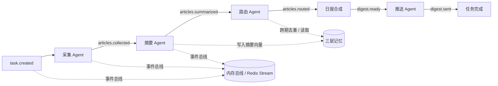

# DailyFeed

多 Agent 协作的日报推送助手：采集 → 摘要 → 路由 → 合成 → 推送，全链路事件驱动。

默认离线可跑（Mock 数据源 + Mock LLM + 内存总线 + SQLite），不依赖任何第三方库；需要真实模型或分布式消息时，再切换 DashScope 与 Redis Stream。

## 特性

- **多 Agent 分工**：采集、摘要、路由、合成、推送各司其职，单个 Agent 可独立替换与测试
- **事件驱动**：每个阶段只消费一个事件、发布下一个事件，上下游异步解耦
- **三层记忆**：全局向量记忆（跨期去重）、RingBuffer 短期记忆（滚动上下文）、任务专属状态（URL 去重）
- **可插拔基础设施**：LLM、事件总线、数据源、通知均可通过环境变量切换
- **指标内置**：任务成功率、路由命中率、跨期去重数、平均耗时

## 架构



事件总线承担两个职责：传递下一阶段事件，以及让任一阶段失败时可重试、可观测。默认的 `MemoryBus` 是进程内队列；设置 `DAILYFEED_BUS=redis` 后切换为 Redis Stream 消费组，Agent 可以拆到独立进程。

## 快速开始

要求 Python 3.10+，无需安装依赖：

```bash
python -m dailyfeed demo
```

演示会连续跑两次任务：第一次订阅 `AI / Agent`，第二次订阅 `开源 / 工程`。第二次中与第一次重复的文章会被全局向量记忆判定为“已推送”并跳过，用来验证跨期去重。

示例输出：

```text
第 1 次运行：AI / Agent
  结果：成功，9 条，跨期去重 0 条，耗时 42.9 ms
  板块分布：AI 6 / 工程 1 / 产品 2
  日报文件：data\digests\digest-20261028-170635-6be4d0bfea98.md

第 2 次运行：开源 / 工程（验证跨期向量去重）
  结果：成功，4 条，跨期去重 4 条，耗时 30.2 ms
  板块分布：工程 3 / AI 1
  日报文件：data\digests\digest-20261028-170635-e93b6b6240f7.md

指标汇总
任务：启动 2 / 成功 2 / 失败 0（成功率 100.0%）
采集：17 篇，跨期去重 4 篇
路由：13 篇，命中 13 篇（命中率 100.0%）
平均任务耗时：36.5 ms
```

其他命令：

```bash
# 执行一次任务（使用 .env 配置，默认 mock 数据源）
python -m dailyfeed run --topics "AI,Agent,开源"

# 查看指标（demo 用独立的 data/demo.db）
python -m dailyfeed stats --db data/demo.db
```

## 目录结构

```text
dailyfeed/
├── domain/                 # 领域层：实体、事件、端口协议
│   ├── models.py           # Article / Summary / RoutedArticle / Digest / Event
│   └── ports.py            # LLM、EventBus、MemoryStore、Repository、Notifier 协议
├── application/            # 应用层
│   ├── agents.py           # 采集 / 摘要 / 路由 / 合成 / 推送 Agent
│   ├── memory.py           # 三层记忆门面
│   └── workflow.py         # 事件驱动编排与失败处理
├── infrastructure/         # 基础设施层
│   ├── llm.py              # MockLLM + DashScopeLLM
│   ├── bus.py              # MemoryBus + RedisStreamBus
│   ├── sources.py          # MockSource + RssSource
│   ├── store.py            # SQLite 仓储、记忆与指标
│   └── notify.py           # 文件 / 邮件推送与 Markdown 渲染
├── interfaces/cli.py       # 命令行入口
├── bootstrap.py            # 组合根：装配各层实现
├── config.py               # 环境变量配置
└── __main__.py
```

分层遵循依赖倒置：`application` 只依赖 `domain` 的协议，具体实现由 `bootstrap.py` 注入，所以换模型、换消息队列、换数据库都不需要改 Agent 代码。

## 三层记忆

| 层 | 作用 | 实现 |
| --- | --- | --- |
| 全局向量记忆 | 存历史摘要向量，用于跨任务去重：新摘要与历史条目相似度 ≥ 阈值即视为已推送 | `global_memory` 表，全量余弦相似度 |
| RingBuffer 短期记忆 | 每个任务保留最近 N 条处理记录，作为路由时的上下文提示 | `short_memory` 表，写入后按 `maxlen` 裁剪 |
| 任务专属状态 | 任务内已见 URL、订阅方向，避免重复采集 | `task_state` 表，键值 JSON |

默认阈值 `0.92`，可通过 `DAILYFEED_DEDUPE_THRESHOLD` 调整。短期记忆长度由 `DAILYFEED_STM_SIZE` 控制。

## 事件链路

| 事件 | 处理者 | 产出 |
| --- | --- | --- |
| `task.created` | 采集 Agent | `articles.collected` |
| `articles.collected` | 摘要 Agent | `articles.summarized` |
| `articles.summarized` | 路由 Agent | `articles.routed` |
| `articles.routed` | 日报合成 | `digest.ready` |
| `digest.ready` | 推送 Agent | `digest.sent` |

任一处理者抛异常，工作流会把任务标记为 `failed`、记录失败指标，并结束本次运行。

## 配置

复制 `.env.example` 为 `.env` 后按需修改，或直接设置环境变量。

| 变量 | 默认值 | 说明 |
| --- | --- | --- |
| `DAILYFEED_LLM` | `mock` | `mock` / `dashscope` |
| `DAILYFEED_BUS` | `memory` | `memory` / `redis` |
| `DAILYFEED_SOURCE` | `mock` | `mock` / `rss` |
| `DAILYFEED_DB` | `data/dailyfeed.db` | SQLite 路径 |
| `DAILYFEED_OUTPUT_DIR` | `data/digests` | 日报输出目录 |
| `DAILYFEED_MAX_ARTICLES` | `20` | 单次最多采集条数 |
| `DAILYFEED_STM_SIZE` | `8` | 短期记忆保留条数 |
| `DAILYFEED_DEDUPE_THRESHOLD` | `0.92` | 跨期去重阈值 |
| `DASHSCOPE_API_KEY` | 空 | 使用 DashScope 时必填 |
| `REDIS_URL` | `redis://localhost:6379/0` | Redis 连接地址 |
| `DAILYFEED_RSS_FEEDS` | 空 | RSS/Atom 地址，英文逗号分隔 |

### 接入真实模型

```bash
export DAILYFEED_LLM=dashscope
export DASHSCOPE_API_KEY=sk-xxxx
python -m dailyfeed run --topics "AI,Agent,开源"
```

摘要与路由走 `qwen-plus`，向量走 `text-embedding-v3`，均通过 DashScope 的 OpenAI 兼容接口调用，不额外引入 SDK。

### 接入 Redis Stream

```bash
pip install -r requirements.txt
docker compose up -d
export DAILYFEED_BUS=redis
python -m dailyfeed run
```

当前实现仍由单进程消费，生产环境可以把每个 Agent 拆成独立 worker，共享同一个消费组。

### 邮件推送

配置 `SMTP_HOST`、`SMTP_USER`、`SMTP_PASSWORD`、`SMTP_TO` 后，推送 Agent 会在落盘的同时发送邮件；未配置时只写本地 Markdown。

## 指标口径

| 指标 | 定义 |
| --- | --- |
| 任务成功率 | `task.succeeded` / `task.started` |
| 路由命中率 | 非“其他”栏目条目数 / 已路由条目数 |
| 跨期去重数 | 被全局向量记忆判定为历史已推送的条目数 |
| 平均任务耗时 | 从发布 `task.created` 到收到 `digest.sent` 的墙钟时间 |

这四项都来自数据库里的 `metrics` 表，`stats` 命令实时聚合。注意：默认 Mock LLM 与 14 条样例数据下，指标只用于验证链路，不代表真实模型效果；换成 DashScope 和真实数据源后才有参考意义。

## 与简历描述的对应

| 简历中的表述 | 本项目的实现 |
| --- | --- |
| DDD 设计 | `domain / application / infrastructure / interfaces` 四层，依赖倒置 |
| Agent Swarm 协作 | 五个 Agent 各自消费一类事件，独立可替换 |
| Redis Stream / Kafka 事件驱动 | `EventBus` 抽象 + `RedisStreamBus` 消费组实现，默认内存实现便于本地运行 |
| 三层记忆解决记忆冗余与上下文污染 | 全局向量记忆 + RingBuffer 短期记忆 + 任务专属状态 |
| 业务成功率 / 路由命中率 | `metrics` 表 + `stats` 命令 |
| 高负载稳定性 | 未包含压测脚本；可用 `run` 循环压测后自行统计 |

## 已知限制

- 向量检索为 Python 全量余弦计算，适合万级以内的演示数据；生产应换 pgvector / Milvus
- 存储使用 SQLite 单文件，多 worker 并发写入需换 PostgreSQL
- 未包含 Neo4j：日报场景不需要图数据库，原简历里的 Neo4j 更适合知识图谱 RAG 项目
- 邮件发送仅支持 SMTP_SSL
- 没有做定时调度：生产可用系统 crontab 或 APScheduler 定时调用 `run`
